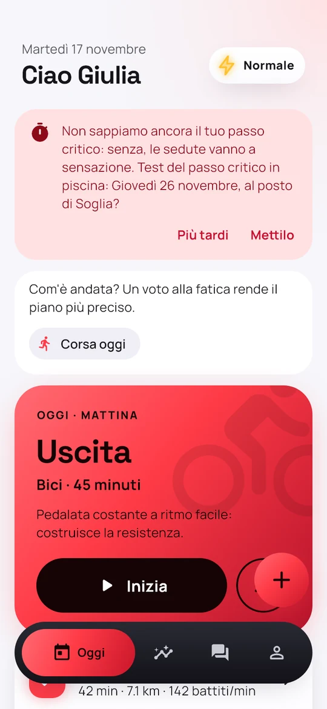
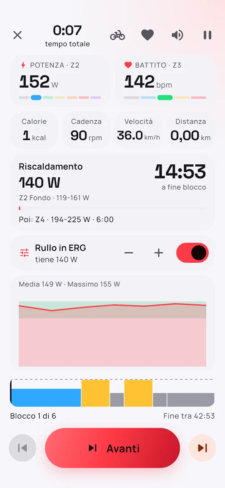
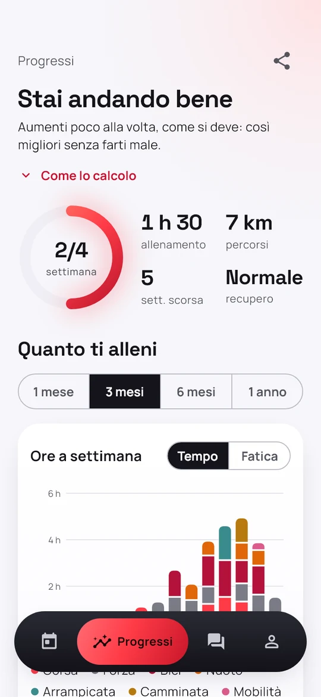
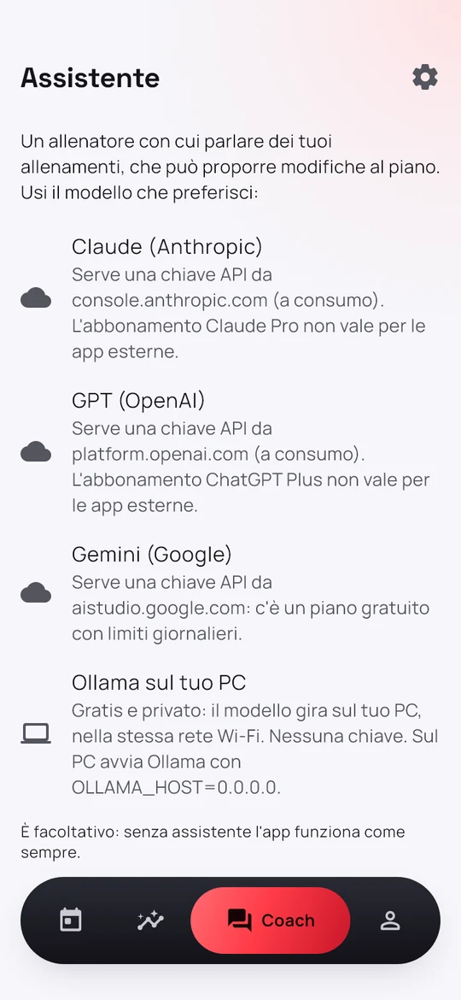

# Avidididadi

[English](README.md) · **Italiano**

Avidididadi è un'app Android (Flutter) per pianificare e seguire gli
allenamenti di forza, corsa, nuoto, bici, mobilità e arrampicata. Prepara un
piano che si adatta a come vanno le sedute, ti guida passo passo durante
l'allenamento (timer, voce, GPS, rullo smart) e mostra i progressi.

**I dati restano sul telefono**: niente server, account, pubblicità o
tracciamento. L'app è in italiano, inglese e greco.

| Oggi | Allenamento guidato | Progressi | Coach |
|---|---|---|---|
| <picture><source media="(prefers-color-scheme: dark)" srcset="docs/screenshots/it/today_dark.webp"></picture> | <picture><source media="(prefers-color-scheme: dark)" srcset="docs/screenshots/it/workout_dark.webp"></picture> | <picture><source media="(prefers-color-scheme: dark)" srcset="docs/screenshots/it/progress_dark.webp"></picture> | <picture><source media="(prefers-color-scheme: dark)" srcset="docs/screenshots/it/coach_dark.webp"></picture> |

<sub>Dati di esempio. L'app ha fondo chiaro o scuro e accento rosso o neon; GitHub mostra le schermate adatte al tuo tema. Per crearle: `flutter test tool/schermate/schermate_test.dart`.</sub>

## Funzioni

- **Piano**: calendario con settimana tipo facoltativa; generatori per forza,
  corsa/nuoto/bici e mobilità; progressione per durata o intensità;
  adattamento ai feedback (fatica, passo) e al recupero.
- **Oggi**: la seduta del giorno, la settimana, l'energia da sonno, HRV e
  battito a riposo, "Com'è andata?" dopo ogni seduta.
- **Allenamento guidato**: un passo alla volta con timer, recuperi, bip e
  voce; GPS per corsa, camminata e bici (anche a schermo spento); percorsi da
  seguire con le indicazioni a voce. La voce può parlare una lingua diversa
  da quella dell'app (italiano, inglese o greco).
- **Rullo smart** (FTMS, es. Tacx Flux S): modalità ERG con i watt di ogni
  blocco, calibrazione dall'app; fasce cardio e sensori della bici via
  Bluetooth.
- **Test delle soglie**: test FTP in bici (a rampa sul rullo o da 20 minuti
  su strada) e di corsa, test del passo critico in piscina; l'FTP si stima
  anche dalle uscite e un test si propone solo quando serve.
- **Health Connect** (solo lettura): sessioni di Garmin, Freeletics e altre
  app, battito, sonno, HRV, percorsi.
- **intervals.icu** (facoltativo, con la tua chiave API): attività complete da
  Garmin, Polar, Suunto…, e le sedute del piano nel tuo calendario di
  intervals.icu (e da lì sull'orologio).
- **Mappe**: MapLibre + OpenFreeMap con i colori del tema; import GPX; zona
  attorno al percorso anche senza rete.
- **Coach** (facoltativo): Claude, GPT o Gemini con la tua chiave API, Ollama
  sul tuo PC, oppure l'app del tuo assistente con un codice di collegamento.
- **Arrampicata**: vie, blocchi e gradi di ogni seduta; allenamenti scritti a
  mano o dall'assistente.
- **Altro**: catalogo esercizi con animazioni, figura dei muscoli, widget per
  la schermata home, immagini da condividere, backup e ripristino su file.

## Installare l'APK

1. Dal telefono apri la pagina
   [Releases](https://github.com/BraveBanana420/avidididadi/releases) e
   scarica `Avidididadi-<versione>-arm64-v8a.apk` (quasi tutti i telefoni
   recenti). Telefoni vecchi a 32 bit: `armeabi-v7a`.
2. Apri il file e, quando Android lo chiede, consenti al browser o al gestore
   file di installare app.
3. Aggiornamenti: installa il nuovo APK sopra il vecchio, i dati restano.
   Tutte le versioni sono firmate con la stessa chiave: un APK compilato da
   altri (o di debug) non si installa sopra.

Facoltativo: controlla il file con `SHA256SUMS.txt` della stessa release.

Serve Android 8.0 (API 26) o successivo. Health Connect serve solo per leggere
i dati di altre app.

## Compilare dal codice

Servono [Flutter](https://docs.flutter.dev/get-started/install) 3.47 (stable,
Dart 3.13), Java 21 e l'SDK Android.

```sh
git clone https://github.com/BraveBanana420/avidididadi.git
cd avidididadi
flutter pub get            # genera anche i testi da lib/l10n/*.arb
flutter analyze            # deve dire "No issues found!"
flutter test
flutter build apk --debug  # versione di debug installabile
```

**Versione di rilascio.** Senza chiave di firma la build si ferma, così un APK
di rilascio non viene mai firmato per sbaglio con la chiave di debug:

1. Crea una chiave una volta sola:
   `keytool -genkey -v -keystore ~/avidididadi-upload.jks -keyalg RSA -keysize 2048 -validity 10000 -alias upload`
2. Copia `android/key.properties.example` in `android/key.properties` e
   scrivi password, alias e percorso completo del file `.jks`. Entrambi i
   file restano fuori da git (vedi `.gitignore`).
3. `flutter build apk --release --split-per-abi --dart-define=COMMIT=$(git rev-parse --short HEAD)`

Le release su GitHub le compila `.github/workflows/release.yml` quando si
carica un'etichetta `v*`.

## Formato dei dati

Tutto è salvato in file CSV (UTF-8, separati da virgola, intestazione nella
prima riga) nella cartella privata dell'app. I principali:

| File | Contenuto |
|---|---|
| `sessioni.csv` | sessioni registrate con l'app o importate |
| `health_connect_sessioni.csv`, `intervals_sessioni.csv` | sessioni lette da Health Connect e intervals.icu |
| `piano.csv`, `settimana_tipo.csv`, `workout.csv`, `programma.csv` | piano, settimana tipo, passi degli allenamenti e quale allenamento va in quale giorno |
| `feedback.csv`, `recupero.csv`, `misure.csv`, `profilo.csv` | feedback, recupero, misure del corpo, profilo |
| `serie.csv`, `nuoto.csv`, `arrampicata.csv` | serie di forza, vasche, arrampicata |
| `percorsi_salvati.csv`, `traccia_<id>.csv` | percorsi da seguire |

Nomi delle colonne e valori salvati (sport, fasce, tipi di seduta) sono in
italiano in tutte le lingue: un backup fatto in inglese si apre in italiano e
viceversa. L'app li traduce solo a schermo.

**Importare sessioni a mano** (Profilo → Dati e collegamenti → Opzioni
avanzate): un CSV con almeno `data` e `sport`:

```csv
id_sessione,data,sport,tipo_sessione,durata_min,distanza_km,fc_media,rpe,fonte,note
,2026-10-15,Corsa,Fartlek,44,6.71,140,7,Manuale,6 x 2 minuti veloci
,2026-10-16,Forza,Corpo intero,40,,120,8,Manuale,
,2026-10-17,Nuoto,Piscina,45,1.15,,6,Manuale,Distanza in km
```

- `data`: `AAAA-MM-GG` (o `GG/MM/AAAA`); `sport`: `Corsa`, `Nuoto`, `Bici`,
  `Forza`, `Mobilità`, `Arrampicata`, `Camminata`.
- `durata_min` minuti, `distanza_km` chilometri, `fc_media` battito medio,
  `rpe` fatica da 1 a 10. `id_sessione` può restare vuoto.

**Backup** (`.gz`): un JSON compresso con gzip,
`{"formato": "avidididadi-backup", "versione": 1, "creato": …, "file": {"nome.csv": "contenuto", …}, "foto": …}`.
Contiene ogni CSV il cui nome rispetta `^[a-z0-9_]+\.csv$` e la foto del
profilo; le chiavi API non ci sono mai.

## Privacy

- Health Connect **solo in lettura**: l'app non scrive e non cancella nulla.
- GPS solo con un allenamento di corsa, camminata o bici aperto; Bluetooth solo
  con la modalità allenamento o la pagina "I miei sensori" aperta.
- Le chiavi API (assistente, intervals.icu) stanno solo nell'archivio cifrato
  di Android: mai nei CSV, nei backup o nei log.
- All'assistente non vanno mai nome, foto o percorsi GPS.
- Informativa completa nell'app: Profilo → Privacy.

## Prossimi passi

- [ ] Altre lingue (contributi benvenuti: vedi `lib/l10n/`)
- [ ] Modo semplice anche per le zone nei testi delle sedute, nei grafici e in
      Progressi
- [ ] Backup su Google Drive
- [ ] Forse: Play Store / F-Droid
- Per ora no: iOS, parte social e classifiche, app per l'orologio.

## Contribuire

Segnalazioni, idee e pull request sono benvenute: leggi
[CONTRIBUTING.md](CONTRIBUTING.md) e il
[Codice di condotta](CODE_OF_CONDUCT.md). Problemi di sicurezza: vedi
[SECURITY.md](SECURITY.md).

Anche senza programmare puoi aiutare con le
[animazioni degli esercizi](docs/animazioni/README.it.md).

## Sostieni il progetto

Avidididadi è gratuita e lo resterà: una donazione non sblocca nulla, aiuta solo
l'app a crescere. Se ti piace, puoi offrirmi un caffè su
[Ko-fi](https://ko-fi.com/avidididadi) (anche dall'app, in Profilo → Sostieni il
progetto). Grazie! 💪

## Licenza

[GNU General Public License v3.0](LICENSE) (GPL-3.0-only).

Contenuti di terzi: caratteri Manrope e Space Grotesk (SIL Open Font License,
`assets/fonts`); esercizi, immagini e istruzioni in inglese da
[free-exercise-db](https://github.com/yuhonas/free-exercise-db) (Unlicense);
mappe © contributori di OpenStreetMap, riquadri di OpenFreeMap; immagini
satellitari © Esri.

L'app non dà consigli medici: piani, zone e valutazione del recupero sono stime
automatiche.
