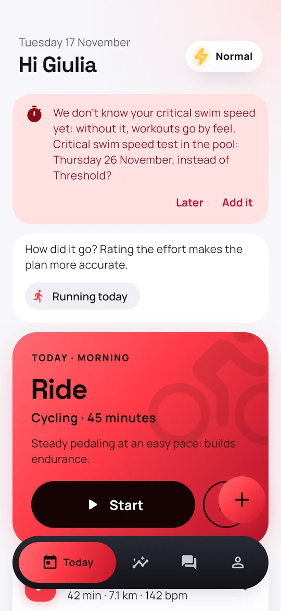
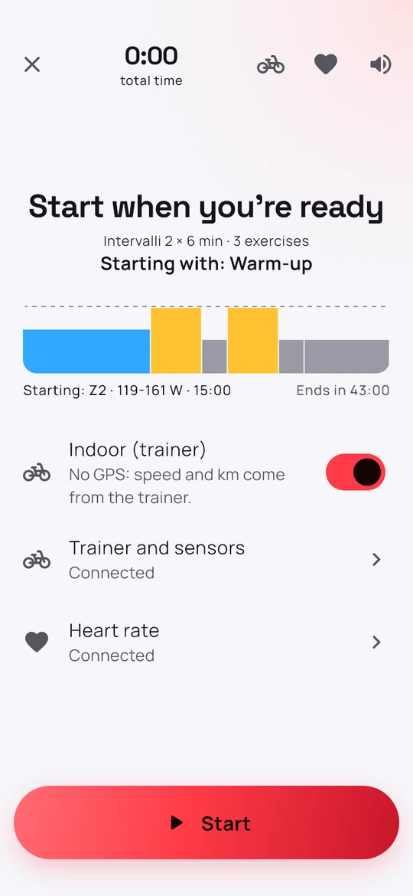
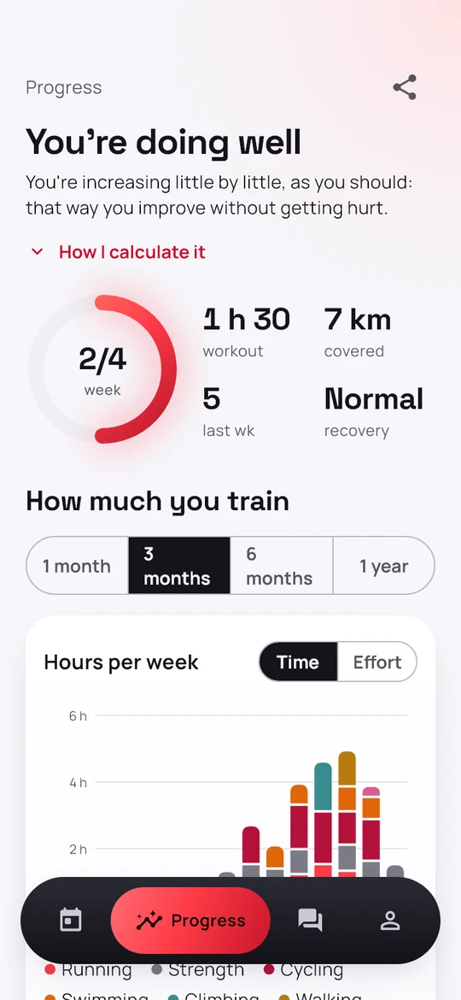
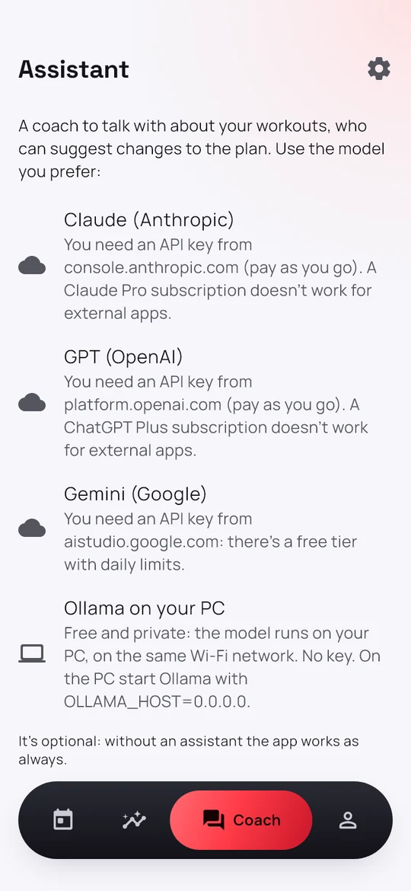

# Avidididadi

**English** · [Italiano](README.it.md)

Avidididadi is an Android app (Flutter) to plan and follow your training:
strength, running, swimming, cycling, mobility and climbing. It builds a plan
that adapts to how your sessions feel, guides you step by step during the
workout (timer, voice, GPS, smart trainer), and shows your progress.

**Your data stays on your phone**: no server, no account, no ads, no tracking.
The app is available in Italian, English and Greek.

| Today | Guided workout | Progress | Coach |
|---|---|---|---|
| <picture><source media="(prefers-color-scheme: dark)" srcset="docs/screenshots/en/today_dark.webp"></picture> | <picture><source media="(prefers-color-scheme: dark)" srcset="docs/screenshots/en/workout_dark.webp"></picture> | <picture><source media="(prefers-color-scheme: dark)" srcset="docs/screenshots/en/progress_dark.webp"></picture> | <picture><source media="(prefers-color-scheme: dark)" srcset="docs/screenshots/en/coach_dark.webp"></picture> |

<sub>Sample data. The app also has a light/dark background and a red or neon accent; GitHub shows the screenshots matching your theme. To produce them: `flutter test tool/schermate/schermate_test.dart --dart-define=LINGUA=en`.</sub>

## Features

- **Plan**: calendar with an optional typical week; generators for strength,
  running/swimming/cycling and mobility; progression by duration or
  intensity; adapts to your feedback (effort, pace) and recovery.
- **Today**: today's session, your week, energy from sleep, HRV and resting
  heart rate, "How did it go?" after each session.
- **Guided workout**: one step at a time with timer, rests, beeps and voice;
  GPS for running, walking and cycling (also with the screen off); routes to
  follow with turn-by-turn voice directions. The voice can speak a different
  language from the app (Italian, English or Greek).
- **Smart trainer** (FTMS, e.g. Tacx Flux S): ERG mode with the watts of each
  block, calibration from the app; heart rate straps and bike sensors via
  Bluetooth.
- **Threshold tests**: bike FTP test (ramp on the smart trainer or 20
  minutes on the road) and running FTP test, critical swim speed test in the
  pool; FTP is also estimated from your rides, and a test is suggested only
  when needed.
- **Health Connect** (read-only): sessions from Garmin, Freeletics and other
  apps, heart rate, sleep, HRV, routes.
- **intervals.icu** (optional, your API key): complete activities from Garmin,
  Polar, Suunto…, and your planned sessions sent to your intervals.icu
  calendar (and from there to your watch).
- **Maps**: MapLibre + OpenFreeMap, themed; GPX import; offline area around a
  route.
- **Coach** (optional): Claude, GPT or Gemini with your API key, Ollama on your
  PC, or your assistant's own app with a link code.
- **Climbing**: routes, problems and grades for each session; hand-written or
  assistant-written workouts.
- **More**: exercise catalog with animations, muscle map, home screen widget,
  shareable images, backup and restore to a file.

## Install the APK

1. On your phone open the [Releases](https://github.com/BraveBanana420/avidididadi/releases)
   page and download `Avidididadi-<version>-arm64-v8a.apk` (almost every
   recent phone). Older 32-bit phones: `armeabi-v7a`.
2. Open the file and allow installing apps from your browser or file manager
   when Android asks.
3. Updates: install the new APK over the old one. Your data stays. All
   releases are signed with the same key: an APK built by someone else (or a
   debug build) can't be installed over it.

Optional: check the file against `SHA256SUMS.txt` in the same release.

Requirements: Android 8.0 (API 26) or later. Health Connect is needed only to
read data from other apps.

## Build from source

You need [Flutter](https://docs.flutter.dev/get-started/install) 3.47 (stable,
Dart 3.13), Java 21 and the Android SDK.

```sh
git clone https://github.com/BraveBanana420/avidididadi.git
cd avidididadi
flutter pub get            # also generates the texts from lib/l10n/*.arb
flutter analyze            # must print "No issues found!"
flutter test
flutter build apk --debug  # installable debug build
```

**Release build.** It refuses to build without a signing key, so a release APK
is never signed with the debug key by mistake:

1. Create a key once:
   `keytool -genkey -v -keystore ~/avidididadi-upload.jks -keyalg RSA -keysize 2048 -validity 10000 -alias upload`
2. Copy `android/key.properties.example` to `android/key.properties` and fill
   in passwords, alias and the full path of the `.jks` file. Both files stay
   out of git (see `.gitignore`).
3. `flutter build apk --release --split-per-abi --dart-define=COMMIT=$(git rev-parse --short HEAD)`

Releases on GitHub are built by `.github/workflows/release.yml` when a `v*`
tag is pushed.

## Data format

Everything is stored as CSV files (UTF-8, comma-separated, header in the
first row) in the app's private folder. Main files:

| File | Content |
|---|---|
| `sessioni.csv` | sessions recorded with the app or imported |
| `health_connect_sessioni.csv`, `intervals_sessioni.csv` | sessions read from Health Connect and intervals.icu |
| `piano.csv`, `settimana_tipo.csv`, `workout.csv`, `programma.csv` | plan, typical week, workout steps and which workout goes on which day |
| `feedback.csv`, `recupero.csv`, `misure.csv`, `profilo.csv` | feedback, recovery, body measurements, profile |
| `serie.csv`, `nuoto.csv`, `arrampicata.csv` | strength sets, pool lengths, climbing |
| `percorsi_salvati.csv`, `traccia_<id>.csv` | routes to follow |

Column names and stored values (sports, times of day, session types) are in
Italian in every language, so a backup made in English opens in Italian and
vice versa. The app only translates them on screen.

**Import sessions by hand** (Profile → Data and connections → Advanced
options): a CSV with at least `data` and `sport`:

```csv
id_sessione,data,sport,tipo_sessione,durata_min,distanza_km,fc_media,rpe,fonte,note
,2026-10-15,Corsa,Fartlek,44,6.71,140,7,Manuale,6 x 2 fast minutes
,2026-10-16,Forza,Corpo intero,40,,120,8,Manuale,
,2026-10-17,Nuoto,Piscina,45,1.15,,6,Manuale,Distance in km
```

- `data`: `YYYY-MM-DD` (or `DD/MM/YYYY`); `sport`: `Corsa` (running),
  `Nuoto` (swimming), `Bici` (cycling), `Forza` (strength), `Mobilità`,
  `Arrampicata` (climbing), `Camminata` (walking).
- `durata_min` minutes, `distanza_km` kilometers, `fc_media` average heart
  rate, `rpe` effort 1–10. `id_sessione` can be empty.

**Backup** (`.gz`): a gzip-compressed JSON with
`{"formato": "avidididadi-backup", "versione": 1, "creato": …, "file": {"name.csv": "content", …}, "foto": …}`.
It contains every CSV whose name matches `^[a-z0-9_]+\.csv$` and the profile
photo; API keys are never included.

## Privacy

- Health Connect is **read-only**; the app never writes or deletes there.
- GPS only while a running, walking or cycling workout is open; Bluetooth only
  with workout mode or the "My sensors" page open.
- API keys (assistant, intervals.icu) are stored only in Android's encrypted
  storage, never in CSV files, backups or logs.
- The assistant never receives your name, photo or GPS routes.
- Full policy inside the app: Profile → Privacy.

## Roadmap

- [ ] More languages (contributions welcome: see `lib/l10n/`)
- [ ] Simple mode also for zones in session texts, charts and Progress
- [ ] Backup to Google Drive
- [ ] Optional: Play Store / F-Droid
- Not planned for now: iOS, social features and leaderboards, a watch app.

## Contributing

Bug reports, ideas and pull requests are welcome: read
[CONTRIBUTING.md](CONTRIBUTING.md) and the
[Code of Conduct](CODE_OF_CONDUCT.md). Security issues: see
[SECURITY.md](SECURITY.md).

## License

[GNU General Public License v3.0](LICENSE) (GPL-3.0-only).

Third-party content: Manrope and Space Grotesk fonts (SIL Open Font License,
`assets/fonts`); exercises, images and English instructions from
[free-exercise-db](https://github.com/yuhonas/free-exercise-db) (Unlicense);
maps © OpenStreetMap contributors, tiles by OpenFreeMap; satellite imagery ©
Esri.

This app is not medical advice. Plans, zones and recovery scores are
automatic estimates.
