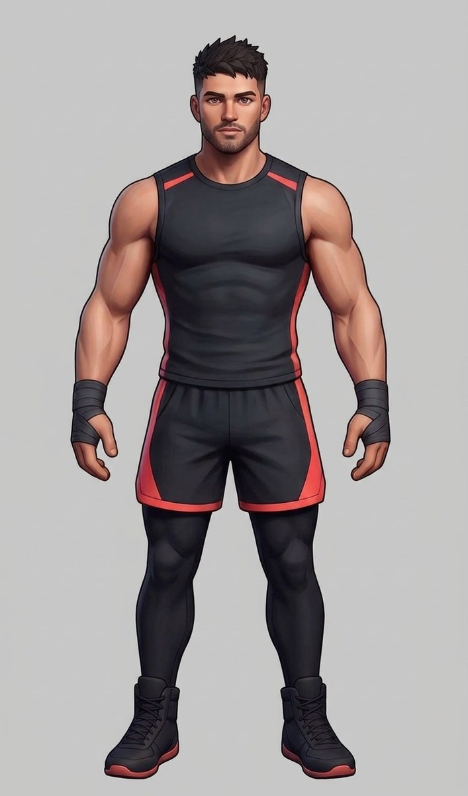
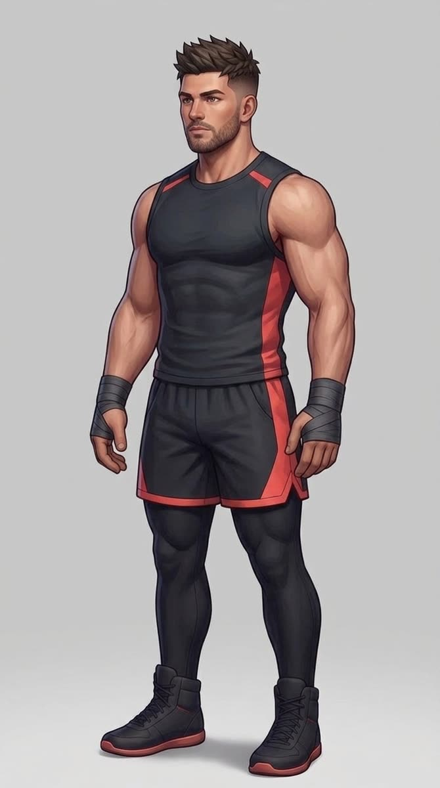
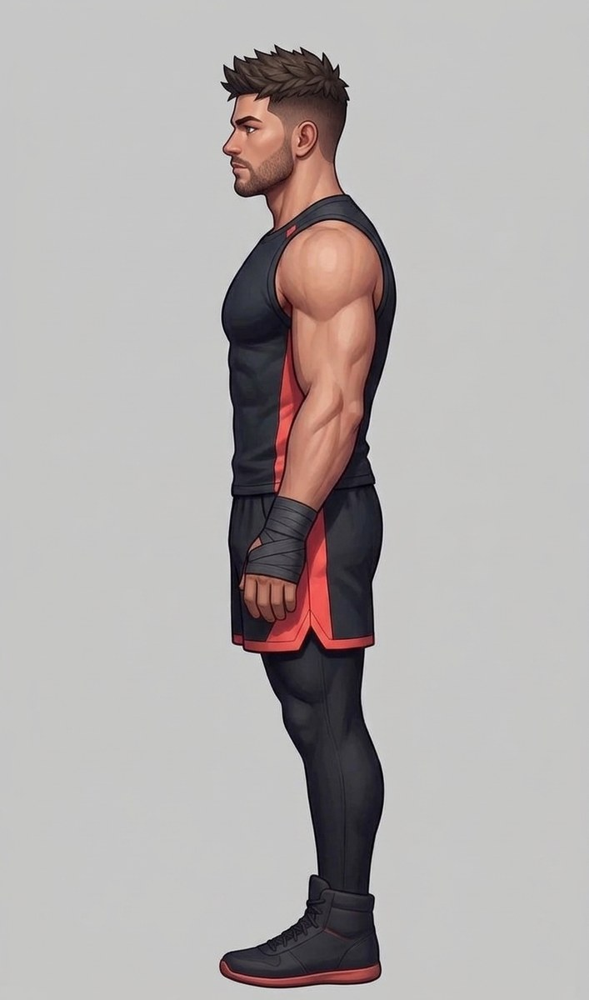
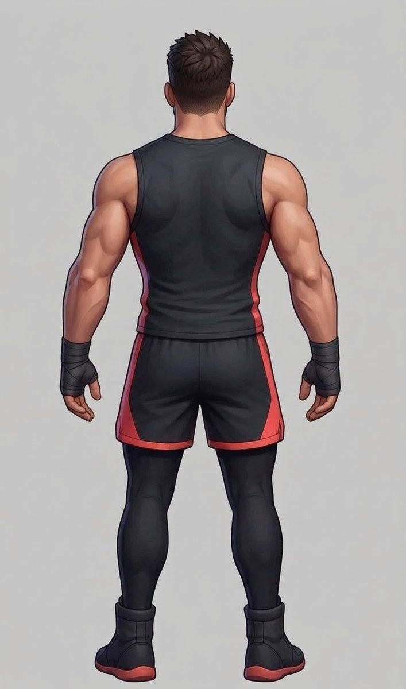
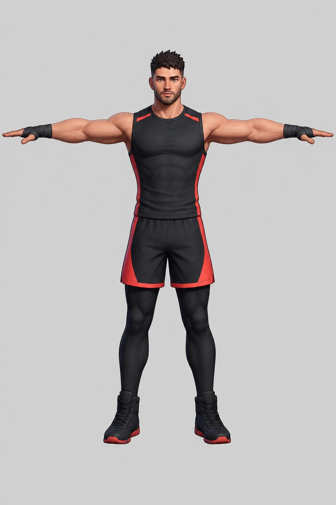
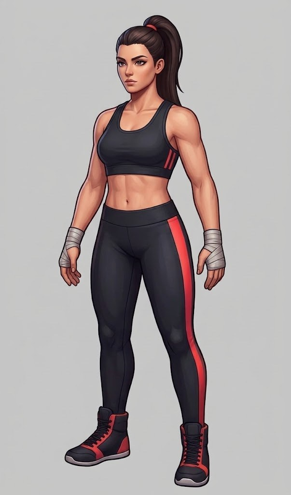

# Animazioni degli esercizi

[English](README.md) · **Italiano**

Ogni esercizio dell'app può mostrare una breve animazione che si ripete: nel
dettaglio dell'esercizio e durante l'allenamento guidato. Partiamo **da zero**: per
ora ogni esercizio mostra due foto. **Puoi aiutare senza scrivere codice.**

L'elenco degli esercizi, con quelli già fatti: [EXERCISES.md](EXERCISES.md).
Parti dalla *Priorità 1*: sono quelli che usa quasi ogni piano.

## Lo stile in una riga

Stesso personaggio, stesso fondo grigio chiaro, inquadratura ferma, una
ripetizione lenta che ricomincia senza scatti. Le prime animazioni accettate
faranno da esempio per le successive.

## I due avatar

Usa uno di questi due personaggi, **esattamente com'è** (viso, capelli, corpo,
vestiti). Un'animazione = un personaggio. Scegli quello che preferisci.

| Uomo: davanti | Uomo: 3/4 | Uomo: lato | Uomo: dietro | Uomo: posa a T | Donna: davanti |
|---|---|---|---|---|---|
|  |  |  |  |  |  |

Vestiti: canotta nera (top sportivo per la donna) con inserti rossi sui fianchi,
leggings neri con righe rosse (sopra, pantaloncini neri per l'uomo), fasce nere ai
polsi, scarpe nere con dettagli rossi. Stile cartone 3D semi-realistico.

Le immagini degli avatar le fornisce solo il progetto: usale come riferimento per
la tua animazione, ma non pubblicare nuove versioni o altre viste degli avatar.

## Regole per ogni animazione

| | |
|---|---|
| **File finale** | WebP animato, **640 × 320 px** (2:1), **15–24 fotogrammi al secondo** (più sono, più è fluida: 24 se il peso lo permette), **2–3 secondi**, ripetizione infinita, senza audio, **al massimo 300 KB** (**400 KB** per gli esercizi con attrezzi o macchine, che hanno più dettagli) |
| **Cosa mandi** | il WebP, oppure un video MP4: lo convertiamo noi |
| **Fondo** | grigio chiaro uniforme (circa `#D9D9DB`), pavimento appena più chiaro, luce morbida da studio |
| **Nient'altro** | niente scritte, loghi, filigrane, palestre o altre persone. Attrezzi solo se l'esercizio li richiede, neri o grigio scuro opachi |
| **Inquadratura** | ferma: niente zoom, movimenti o tagli. **Da 3/4** (corpo girato di circa 45°, come l'avatar "Uomo: 3/4") per quasi tutti gli esercizi: si vedono insieme la profondità e il lato del movimento. **Di lato** o **di fronte** solo quando da 3/4 il movimento non si capisce bene (es. di fronte per jumping jack e alzate laterali, di lato per alcuni esercizi a terra) |
| **Spazio** | tutto il corpo e gli attrezzi sempre dentro, con un po' di margine; piedi vicini al bordo in basso |
| **Movimento** | **una ripetizione completa**, lenta e controllata, con la tecnica giusta. Finisce esattamente nella posizione di partenza, così il giro è continuo |
| **Personaggio** | uguale alle immagini degli avatar in ogni fotogramma (viso, capelli, corpo, vestiti). Li confrontiamo prima di accettarla: se qualcosa è cambiato, riprova |

Per la tecnica giusta segui le istruzioni dell'esercizio in
[`assets/esercizi.json`](../../assets/esercizi.json) (campo `istruzioni`), le
stesse che mostra l'app.

## Come farla

Ogni animazione è un **video 2D che parte dalle immagini degli avatar**: prima
un'immagine ferma dell'avatar nella posizione di partenza dell'esercizio, poi uno
strumento da immagine a video che la anima. Gli avatar sono nati così, e lo stile
resta uguale. Non servono modelli 3D. Va bene qualsiasi strumento per immagini e
video, purché le sue condizioni permettano di pubblicare il risultato (vedi
[Licenza e diritti](#licenza-e-diritti-importante)).

Perché serve l'immagine in più? Uno strumento da immagine a video usa la foto che
gli dai come **primo fotogramma**: partendo dall'avatar in piedi, il video
mostrerebbe il personaggio che si mette in posizione, e il giro non si
chiuderebbe. Alcuni strumenti video possono invece usare l'avatar come
**riferimento del personaggio** e creare direttamente l'esercizio: va bene anche
così, purché il personaggio resti identico e il risultato rispetti le regole.

### 1. Immagine di partenza (es. Nano Banana / Gemini)

Carica le immagini dell'avatar (3/4, davanti e lato) e chiedi la posizione di partenza.
Se l'esercizio parte in piedi, l'avatar da 3/4 può già essere la posizione di
partenza: allargalo a 16:9 con lo stesso fondo e passa al punto 2.
Le richieste funzionano meglio in inglese, quindi lasciale così:

```text
Use the attached character exactly as he is: same face, hair, body and outfit
(black sleeveless top with red side panels, black shorts over black leggings with
red stripes, black wrist wraps, black shoes with red details), same semi-realistic
3D cartoon style.
Show him in the starting position of: <EXERCISE NAME> (<one line from the
instructions>), seen in the same three-quarter view as the attached image
<or: from the side / from the front>.
Full body visible with some margin, plain light grey background (#D9D9DB) with a
slightly lighter floor, soft studio light. No text, no logo, no other objects
<except: EQUIPMENT in matte black>. Wide 2:1 image.
```

Per la donna sostituisci "he" e i vestiti con "she" e "black sports bra with red
details, black leggings with red stripes, ...".

### 2. Animazione (uno strumento da immagine a video, es. Dreamina, Kling, Runway, Veo)

Dagli l'immagine di partenza. Se lo strumento permette di scegliere il **primo e
l'ultimo fotogramma**, usa la stessa immagine per tutti e due: il giro sarà continuo.

```text
The character performs one slow, controlled repetition of <EXERCISE NAME>:
<the movement in one or two lines>. Correct technique, realistic body mechanics.
The character, outfit and background stay exactly as in the image.
The camera is completely still: no zoom, no pan, no cuts. The movement ends exactly in the starting position, so the video
loops seamlessly. No text.
```

Fanne qualche versione e tieni quella con la tecnica migliore: mani, piedi e
articolazioni non devono piegarsi in modo strano.

### 3. Conversione in WebP (facoltativa)

Se hai [ffmpeg](https://ffmpeg.org/), taglia la ripetizione migliore (`-ss` è dove
inizia, `-t` quanto dura) e converti:

```sh
ffmpeg -ss 0.5 -t 2.0 -i video.mp4 -an \
  -vf "fps=24,scale=640:320:force_original_aspect_ratio=increase,crop=640:320" \
  -c:v libwebp -quality 75 -compression_level 6 -loop 0 id_esercizio.webp
```

Se il file supera il limite abbassa `-quality` (es. 60), usa `fps=20` o `fps=15`, oppure accorcia `-t`. Se non hai
ffmpeg, manda direttamente l'MP4.

## Licenza e diritti (importante)

- Le animazioni sono pubblicate con licenza **[CC0 1.0](https://creativecommons.org/publicdomain/zero/1.0/deed.it)**
  (pubblico dominio, come le foto degli esercizi): chiunque può riusarle. Anche i
  due avatar sono CC0.
- Manda solo cose **fatte da te**. Mai spezzoni, fotogrammi o personaggi presi da
  altre app, siti, video o giochi, e mai persone vere.
- Se usi uno strumento di intelligenza artificiale, controlla che le sue condizioni
  permettano di pubblicare il risultato in un progetto open source (alcuni piani
  gratuiti no, o aggiungono una filigrana) e **scrivi quali strumenti e quale piano
  hai usato** (gratuito o a pagamento). Se non sei sicuro, chiedi nella issue prima
  di mandarla: meglio aspettare che pubblicare qualcosa che non si può usare.
- **Manda anche le condizioni**, per ogni strumento usato (quello per l'immagine e
  quello per il video): il link alle condizioni d'uso e, se è separata, alla pagina
  del piano, più uno screenshot o un PDF della parte che dice di chi sono i
  risultati e se si possono pubblicare o usare per scopi commerciali, e la data in
  cui hai fatto l'animazione (le condizioni cambiano nel tempo). Le leggiamo prima
  di accettarla: se non lo permettono non possiamo pubblicarla, anche se è bellissima.
- Se l'animazione è fatta con l'IA, **manda anche il video originale** così com'è
  uscito dallo strumento, senza convertirlo: spesso contiene le credenziali che dicono
  "generato con IA", e alcune condizioni vietano di toglierle. Lo teniamo in
  [`originali/`](originali/) e scriviamo strumenti, data e termini in
  [FONTI.md](FONTI.md), dove l'animazione è segnata come fatta con l'IA.

## Come mandarla

1. Guarda [EXERCISES.md](EXERCISES.md) e le issue aperte, per non fare in due lo
   stesso esercizio.
2. Apri una issue con il modulo **Exercise animation / Animazione esercizio**,
   scrivendo su quale esercizio stai lavorando.
3. Quando è pronta, trascina il WebP o l'MP4 nella issue (al massimo 10 MB),
   insieme alle condizioni degli strumenti usati.
4. Noi controlliamo l'animazione e le condizioni, poi la aggiungiamo all'app.

Sai usare Git? Apri invece una pull request verso `staging`:

- aggiungi il file in `assets/exercises/animated/`, con l'ID dell'esercizio in
  minuscolo (`Bodyweight_Walking_Lunge` → `bodyweight_walking_lunge.webp`);
- aggiungi una riga in `animazioniEsercizi` in `lib/animazioni_esercizi.dart`;
- lancia `python tool/elenco_animazioni.py` per aggiornare [EXERCISES.md](EXERCISES.md).

Grazie! 💪
