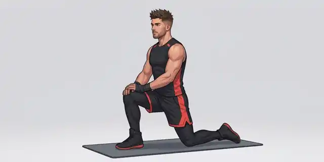

# Animazioni degli esercizi

[English](README.md) · **Italiano**

Ogni esercizio dell'app può mostrare una breve animazione che si ripete, nel
dettaglio dell'esercizio e durante l'allenamento guidato. Per ora quasi tutti
mostrano ancora due foto: **puoi aiutare anche senza saper programmare**.

Le animazioni devono sembrare tutte **lo stesso disegno**, chiunque le faccia.
Per questo c'è **una sola ricetta**, uguale per tutti e che non si cambia: lo
script [`agents/animazione.mjs`](../../agents/animazione.mjs) con le richieste
approvate in [`richieste.json`](richieste.json). Animazioni fatte in un altro
modo (altri strumenti, altre richieste, conversioni a mano) non possiamo
accettarle, anche se sono belle.

| Squat | Leg extension | Flessori dell'anca |
|---|---|---|
|  |  |  |

## Tre modi per aiutare

1. **Fare un'animazione** con la ricetta, usando i tuoi crediti OpenRouter
   (da **0,15 a 0,25 $** a esercizio, circa 0,15 $ in più se serve un secondo
   video). Si parte dagli esercizi 🟢 di [EXERCISES.md](EXERCISES.md): hanno già
   una richiesta approvata. Servono un computer e qualche comando nel terminale,
   copiati da qui sotto.
2. **Proporre la richiesta** per un esercizio ⬜ (non costa niente): in una issue
   scrivi da dove si guarda, la posizione di partenza e il movimento (vedi
   [Esercizio senza richiesta](#esercizio-senza-richiesta)). Quando la
   approviamo, l'esercizio diventa 🟢 e chiunque può farlo.
3. **Una donazione** su [Ko-fi](https://ko-fi.com/avidididadi), se non hai tempo
   ma vuoi sostenere il progetto.

## La ricetta (non si cambia)

| | Sempre così |
|---|---|
| **Personaggio** | l'avatar uomo del progetto ([`avatar/`](avatar/)), identico in ogni fotogramma |
| **Vista, partenza e movimento** | solo da [`richieste.json`](richieste.json), approvate dal progetto |
| **Tipo** | **animazione** (un video che si ripete) oppure **posizione** (`"tipo": "posizione"`): un'immagine ferma, per gli allungamenti in cui si resta fermi, che si vedono meglio così e costano meno |
| **Immagine di partenza** | l'avatar stesso (esercizi che partono in piedi), oppure **Nano Banana 2.1** (Google) dagli avatar, con un testo fisso |
| **Video** | **Seedance 2.0 Mini** (ByteDance), 480p, 4 s, senza audio, seed 42, primo e ultimo fotogramma = l'immagine di partenza, con un testo fisso |
| **Dove** | l'API di [OpenRouter](https://openrouter.ai), con la tua chiave |
| **WebP** | 640 × 320, fondo `#D9D9DB`, luce uniformata, 15-24 fps, 2-3 s, al massimo 300 KB (400 KB con attrezzi): lo fa lo script, sceglie da solo il più fluido che sta nel limite |

I testi mandati ai modelli li scrive lo script, non tu. Non modificare lo
script, `richieste.json` o le impostazioni: il comando `controlla` se ne
accorge, e noi lo rilanciamo sui file che mandi con la nostra copia.
Lo script e le richieste li cambia solo il progetto. Quando cambiano, sale il
numero della ricetta (`RICETTA` nello script) e si usa quella nuova.

## Cosa ti serve

- **Una copia della repo**, dal ramo `staging`: `git clone -b staging https://github.com/BraveBanana420/avidididadi.git`,
  oppure *Code → Download ZIP* da GitHub, scegliendo prima il ramo `staging`.
  Prima di iniziare un esercizio aggiornala, così hai la ricetta e le richieste attuali.
- **[Node.js](https://nodejs.org) 18** o più recente.
- **[ffmpeg](https://ffmpeg.org/download.html) 8** o più recente (su Windows:
  `winget install Gyan.FFmpeg`, poi riapri il terminale).
- **Un account OpenRouter con qualche credito** e una **chiave con un tetto di
  spesa** (per esempio 1 $), creata in [openrouter.ai/settings/keys](https://openrouter.ai/settings/keys).
  Mettila nel terminale, **non** in un file della repo:
  - Windows (PowerShell): `$env:OPENROUTER_VIDEO_KEY = "sk-or-..."`
  - macOS / Linux: `export OPENROUTER_VIDEO_KEY="sk-or-..."`

  La chiave non finisce in nessun file che mandi. Non scriverla mai in una issue.

Tutti i comandi si lanciano dalla cartella della repo. `node agents/animazione.mjs credito`
ti dice quanto resta sulla chiave; lo script si ferma da solo prima di
spendere se il credito non basta.

## Passo per passo

Esempio con `Shoulder_Stretch`: al suo posto metti l'ID del tuo esercizio.
`../lavoro/Shoulder_Stretch` è la cartella di lavoro, accanto alla repo e non
dentro, così non finisce in git per sbaglio: lo script la crea da solo.

**0. Scegli e prenota.** Prendi un esercizio 🟢 da [EXERCISES.md](EXERCISES.md),
controlla che non ci sia già una issue aperta e aprine una con il modulo
**Exercise animation / Animazione esercizio**. Poi guarda la richiesta e quanto costa:

```sh
node agents/animazione.mjs richiesta --esercizio Shoulder_Stretch
```

**1. Immagine di partenza.**

```sh
node agents/animazione.mjs partenza ../lavoro/Shoulder_Stretch --esercizio Shoulder_Stretch
```

Se l'esercizio parte in piedi è gratis: l'immagine è l'avatar. Altrimenti
Nano Banana ne fa 2 (`partenza_1.jpg`, `partenza_2.jpg`, circa 0,09 $). Aprile e
scegli la migliore: personaggio identico all'avatar (viso, barba, capelli,
vestiti, leggings neri **senza** righe), posizione giusta, il lato giusto (vedi
[Per lato](#regole-che-guardiamo-a-occhio)), attrezzo senza marchi, tutto dentro
l'immagine. Se nessuna va bene puoi rilanciare il comando una volta; se ancora
non va, scrivilo nella issue invece di spendere ancora.

**2. Video.** (1-3 minuti, circa 0,15 $)

```sh
node agents/animazione.mjs video ../lavoro/Shoulder_Stretch --esercizio Shoulder_Stretch --immagine partenza_1.jpg
```

Apri `anteprima-video.jpg` (6 fotogrammi) e, se vuoi, `video.mp4`. Controlla
che la tecnica sia giusta, che il personaggio sia uguale dall'inizio alla fine
e che resti **disegnato** fino all'ultimo fotogramma. A volte a metà diventa un
3D realistico: in quel caso scartalo. Per riprovare rilancia lo stesso comando:
costa un altro video. Dopo due video sbagliati fermati e scrivilo nella issue.

**3. WebP.**

```sh
node agents/animazione.mjs converti ../lavoro/Shoulder_Stretch --esercizio Shoulder_Stretch
```

Guarda `anteprima-webp.png`. Se lo script avvisa che il giro potrebbe saltare
(di solito la telecamera si sposta negli ultimi fotogrammi), trova il
fotogramma che torna uguale al primo e rifai con `--fine <numero>`. Aggiungi
anche `--accelera 1` se così dura già 2-3 secondi. Negli allungamenti tenuti puoi
fermare la posizione per qualche secondo con `--pausa <fotogramma>:<secondi>`
(al massimo 3 s, es. `--pausa 50:2`), così si capisce che lì si resta.

Se la richiesta è di tipo **posizione** salta il video: dopo il passo 1
lancia `node agents/animazione.mjs ferma ../lavoro/<ID> --esercizio <ID> --immagine partenza_1.jpg`
(con l'immagine che hai scelto), poi vai al passo 4. Costa solo l'immagine.

**4. Controllo.**

```sh
node agents/animazione.mjs controlla ../lavoro/Shoulder_Stretch --esercizio Shoulder_Stretch
```

Deve finire con "Tutto a posto". Ogni riga `NO` dice cosa non va.

**5. Mandala.** Comprimi **tutta la cartella** (`../lavoro/Shoulder_Stretch`) in
uno ZIP e trascinalo nella issue, insieme al testo stampato da `controlla`.
Dentro ci sono il video originale, l'immagine di partenza, i testi mandati ai
modelli e `meta.json`: ci servono per controllarla. Se lo ZIP supera i 25 MB,
lascia fuori `partenza_2.jpg` e le anteprime.

Sai usare Git? Puoi anche aprire una pull request verso `staging` dopo aver lanciato
`node agents/animazione.mjs integra ../lavoro/Shoulder_Stretch --esercizio Shoulder_Stretch --autore <il tuo nome GitHub>`
(ci vuole anche Python): mette WebP, video originale, ricetta e fonti al
posto giusto e aggiorna [EXERCISES.md](EXERCISES.md). Nella PR non cambiare
nient'altro.

Noi rilanciamo `controlla` sui tuoi file, guardiamo l'animazione e, se va
bene, la mettiamo nell'app con il tuo nome in [FONTI.md](FONTI.md).

## Esercizio senza richiesta

Per un esercizio ⬜ apri la issue e scrivi, **in inglese** (i modelli lo capiscono meglio):

- **Tipo**: `animazione` se c'è un movimento da vedere, `posizione` se si resta
  fermi (allora la posa è la posizione tenuta e il movimento non serve);
- **Vista**: `tre_quarti` (corpo girato di circa 45°: è quella di quasi tutti gli
  esercizi), `lato` o `fronte` (solo se da 3/4 il movimento non si capisce bene,
  per esempio di fronte per le alzate laterali);
- **Partenza**: `avatar` se l'esercizio parte in piedi a corpo libero, altrimenti `genera`;
- **Posa** (solo con `genera`): la posizione di partenza in frasi complete, che
  iniziano con "He…", con gli attrezzi e, per gli esercizi per lato, quale lato
  è giù o avanti;
- **Movimento**: una sola ripetizione lenta, con "he" come soggetto, che finisce nella
  posizione di partenza.

Prendi spunto dalle richieste che ci sono già in [`richieste.json`](richieste.json)
e dalle istruzioni dell'esercizio in [`assets/esercizi.json`](../../assets/esercizi.json)
(campo `istruzioni_en`). **Non spendere niente finché non la approviamo**: la
aggiungiamo noi a `richieste.json`, e da lì vale per tutti.

## Regole che guardiamo a occhio

Lo script pensa a formato, fondo, peso e giro. Queste invece le giudichi tu
guardando le anteprime, e poi le controlliamo noi:

| | |
|---|---|
| **Stile** | disegnato come gli avatar (contorni scuri, ombre morbide, colori uniformi) **dal primo all'ultimo fotogramma**: niente foto né 3D realistico |
| **Personaggio** | uguale all'avatar in ogni fotogramma: viso, barba, capelli, corpo, vestiti (canotta nera con inserti rossi, pantaloncini neri sopra leggings neri, fasce nere ai polsi, scarpe nere con suola rossa) |
| **Movimento** | una ripetizione completa, lenta e controllata, con la tecnica giusta: mani, piedi e articolazioni non si piegano in modo strano |
| **Inquadratura** | ferma: niente zoom, movimenti o tagli; tutto il corpo e gli attrezzi sempre dentro |
| **Nient'altro** | niente scritte, loghi, filigrane, palestre o altre persone. Attrezzi solo se l'esercizio li richiede, neri o grigio scuro opachi |
| **Per lato** (↔ in [EXERCISES.md](EXERCISES.md)) | solo il **lato destro** (quello che lavora o si allunga): l'app specchia l'animazione per il sinistro. Il personaggio non cambia lato nel video. Dettagli in [LATI.md](LATI.md) |

## Licenza e diritti (importante)

- Le animazioni sono pubblicate con licenza **[CC0 1.0](https://creativecommons.org/publicdomain/zero/1.0/deed.it)**
  (pubblico dominio, come le foto degli esercizi): chiunque può riusarle. Anche gli
  avatar sono CC0. Mandandone una, accetti di pubblicarla così.
- Le condizioni dei due modelli le abbiamo già lette noi (vedi
  [FONTI.md](FONTI.md)): chi ha fatto il risultato ne è il proprietario e può
  pubblicarlo, purché si dica che è fatto con l'IA e non si tolgano le
  credenziali dal video. Per questo non devi mandarci le condizioni, ma solo
  usare la ricetta così com'è.
- Il **video originale** resta in [`originali/`](originali/) così com'è uscito,
  perché contiene le credenziali "generato con IA" (C2PA). Strumenti, data e
  autore vanno in [FONTI.md](FONTI.md), dove l'animazione è segnata come fatta con l'IA.
- Usa solo l'avatar del progetto: mai personaggi, fotogrammi o spezzoni presi
  da altre app, siti, video o giochi, e mai persone vere. Le immagini degli
  avatar le fornisce solo il progetto: non pubblicarne nuove versioni o altre viste.
- **La scritta sotto l'esercizio cambia da sola.** Le foto vengono da
  free-exercise-db, e il dettaglio dell'esercizio lo dice ("Immagini da
  free-exercise-db"). Quando un'animazione nostra prende il posto delle foto
  (cioè l'esercizio è in `lib/animazioni_esercizi.dart`), quella scritta va
  tolta: al suo posto l'app scrive "Animazione creata con l'intelligenza
  artificiale per Avidididadi" (`animazioneFattaConIa`). Se un giorno arriva
  un'animazione fatta senza IA, va cambiato anche questo testo.

Grazie! 💪
