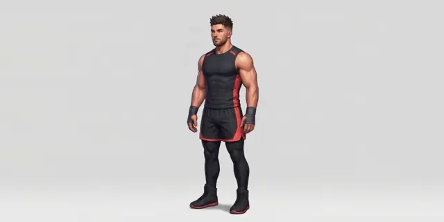
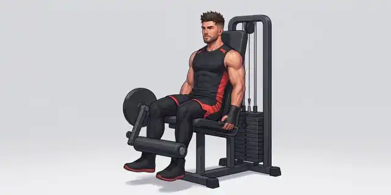

# Exercise animations

**English** · [Italiano](README.it.md)

Every exercise in the app can show a short looping animation, on the exercise
page and during the guided workout. For now almost all of them still show two
photos: **you can help even if you can't code**.

All the animations must look like **the same drawing**, whoever makes them.
That's why there is **a single recipe**, the same for everyone, and it doesn't
change: the script [`agents/animazione.mjs`](../../agents/animazione.mjs) with
the approved requests in [`richieste.json`](richieste.json). We can't accept
animations made any other way (other tools, other prompts, manual
conversions), even beautiful ones.

| Squat | Leg extension | Kneeling hip flexor |
|---|---|---|
|  |  |  |

## Three ways to help

1. **Make an animation** with the recipe, using your own OpenRouter credits
   (**$0.15 to $0.25** per exercise, about $0.15 more if a second video is
   needed). Start from the 🟢 exercises in [EXERCISES.md](EXERCISES.md): they
   already have an approved request. You need a computer and a few terminal
   commands, copied from below.
2. **Propose the request** for a ⬜ exercise (free): in an issue, write the
   view, the starting position and the movement (see
   [Exercise without a request](#exercise-without-a-request)). Once we approve
   it, the exercise becomes 🟢 and anyone can make it.
3. **A donation** on [Ko-fi](https://ko-fi.com/avidididadi), if you have no
   time but want to support the project.

## The recipe (it doesn't change)

| | Always like this |
|---|---|
| **Character** | the project's male avatar ([`avatar/`](avatar/)), identical in every frame |
| **View, start and movement** | only from [`richieste.json`](richieste.json), approved by the project |
| **Starting image** | the avatar itself (exercises that start standing), or **Nano Banana 2.1** (Google) from the avatars, with a fixed prompt |
| **Video** | **Seedance 2.0 Mini** (ByteDance), 480p, 4 s, no audio, seed 42, first and last frame = the starting image, with a fixed prompt |
| **Where** | the [OpenRouter](https://openrouter.ai) API, with your own key |
| **WebP** | 640 × 320, background `#D9D9DB`, even lighting, 15-24 fps, 2-3 s, at most 300 KB (400 KB with equipment): the script does it and picks the smoothest version within the limit |

The script writes the prompts, not you. Don't change the script,
`richieste.json` or the settings: the `controlla` command notices, and we run
it again on the files you send, with our own copy.
Only the project changes the script and the requests. When they change, the
recipe number (`RICETTA` in the script) goes up and the new one is used.

## What you need

- **A copy of the repo**, from the `staging` branch: `git clone -b staging https://github.com/BraveBanana420/avidididadi.git`,
  or *Code → Download ZIP* on GitHub after choosing the `staging` branch.
  Update it before starting an exercise, so you have the current recipe and requests.
- **[Node.js](https://nodejs.org) 18** or newer.
- **[ffmpeg](https://ffmpeg.org/download.html) 8** or newer (on Windows:
  `winget install Gyan.FFmpeg`, then reopen the terminal).
- **An OpenRouter account with some credits** and a **key with a spending
  limit** (for example $1), created at [openrouter.ai/settings/keys](https://openrouter.ai/settings/keys).
  Set it in the terminal, **not** in a file of the repo:
  - Windows (PowerShell): `$env:OPENROUTER_VIDEO_KEY = "sk-or-..."`
  - macOS / Linux: `export OPENROUTER_VIDEO_KEY="sk-or-..."`

  The key doesn't end up in any file you send. Never write it in an issue.

Run every command from the repo folder. `node agents/animazione.mjs credito`
tells you what's left on the key; the script stops by itself before spending
if the credit isn't enough.

## Step by step

Example with `Shoulder_Stretch`: use your exercise's ID instead.
`../work/Shoulder_Stretch` is the work folder, next to the repo and not inside
it, so it can't end up in git by mistake: the script creates it.

**0. Choose and book it.** Pick a 🟢 exercise from [EXERCISES.md](EXERCISES.md),
check there's no open issue for it yet and open one with the **Exercise
animation / Animazione esercizio** form. Then look at the request and its cost:

```sh
node agents/animazione.mjs richiesta --esercizio Shoulder_Stretch
```

**1. Starting image.**

```sh
node agents/animazione.mjs partenza ../work/Shoulder_Stretch --esercizio Shoulder_Stretch
```

If the exercise starts standing it's free: the image is the avatar. Otherwise
Nano Banana makes 2 (`partenza_1.jpg`, `partenza_2.jpg`, about $0.09). Open them
and pick the best: character identical to the avatar (face, beard, hair,
outfit, black leggings **without** stripes), right position, right side (see
[One side](#rules-we-check-by-eye)), equipment without brands, everything
inside the image. If none is good you may run the command once more; if it
still isn't, say so in the issue instead of spending more.

**2. Video.** (1-3 minutes, about $0.15)

```sh
node agents/animazione.mjs video ../work/Shoulder_Stretch --esercizio Shoulder_Stretch --immagine partenza_1.jpg
```

Open `anteprima-video.jpg` (6 frames) and, if you like, `video.mp4`. Check
that the technique is right, that the character stays the same from start to
end and that it stays **drawn** until the last frame. Sometimes it turns into
realistic 3D halfway through: then throw it away. To try again run the same
command: it costs another video. After two wrong videos, stop and say so in the issue.

**3. WebP.**

```sh
node agents/animazione.mjs converti ../work/Shoulder_Stretch --esercizio Shoulder_Stretch
```

Look at `anteprima-webp.png`. If the script warns that the loop may jump
(usually the camera moves in the last frames), find the frame that looks like
the first again and redo it with `--fine <number>`. Also add `--accelera 1` if
it's already 2-3 seconds long that way.

**4. Check.**

```sh
node agents/animazione.mjs controlla ../work/Shoulder_Stretch --esercizio Shoulder_Stretch
```

It must end with "All good". Every `NO` line says what's wrong.

**5. Send it.** Zip **the whole folder** (`../work/Shoulder_Stretch`) and drag the
ZIP into the issue, together with the text printed by `controlla`. It holds the
original video, the starting image, the prompts sent to the models and
`meta.json`: we need them to check it. If the ZIP is over 25 MB, leave out
`partenza_2.jpg` and the previews.

Know Git? You can also open a pull request against `staging` after running
`node agents/animazione.mjs integra ../work/Shoulder_Stretch --esercizio Shoulder_Stretch --autore <your GitHub name>`
(it also needs Python): it puts the WebP, the original video, the recipe and
the sources in the right places and updates [EXERCISES.md](EXERCISES.md).
Don't change anything else in the PR.

We run `controlla` again on your files, look at the animation and, if it's
good, add it to the app with your name in [FONTI.md](FONTI.md).

## Exercise without a request

For a ⬜ exercise, open the issue and write, **in English**:

- **View**: `tre_quarti` (body turned about 45°: the view for almost every
  exercise), `lato` (side) or `fronte` (front), only if the movement isn't
  clear from 3/4 (for example from the front for lateral raises);
- **Start**: `avatar` if the exercise starts standing with no equipment, otherwise `genera`;
- **Pose** (only with `genera`): the starting position in full sentences,
  starting with "He…", with the equipment and, for one-side exercises, which
  side is down or forward;
- **Movement**: a single slow repetition, with "he" as the subject, and ending in the
  starting position.

Take a cue from the requests already in [`richieste.json`](richieste.json) and
from the exercise instructions in [`assets/esercizi.json`](../../assets/esercizi.json)
(field `istruzioni_en`). **Don't spend anything until we approve it**: we add
it to `richieste.json`, and from there it holds for everyone.

## Rules we check by eye

The script takes care of format, background, size and loop. These you judge
by looking at the previews, and then we check them:

| | |
|---|---|
| **Style** | drawn like the avatars (dark outlines, soft shading, flat colours) **from the first to the last frame**: no photo, no realistic 3D |
| **Character** | identical to the avatar in every frame: face, beard, hair, body, outfit (black tank top with red side panels, black shorts over black leggings, black wrist wraps, black shoes with red soles) |
| **Movement** | one full repetition, slow and controlled, with the right technique: hands, feet and joints don't bend in strange ways |
| **Framing** | still: no zoom, no camera moves, no cuts; the whole body and equipment always inside |
| **Nothing else** | no text, logos, watermarks, gyms or other people. Equipment only if the exercise needs it, matte black or dark grey |
| **One side** (↔ in [EXERCISES.md](EXERCISES.md)) | only the **right side** (the one that works or stretches): the app mirrors the animation for the left. The character doesn't switch sides in the video. Details in [LATI.md](LATI.md) |

## License and rights (important)

- Animations are published under **[CC0 1.0](https://creativecommons.org/publicdomain/zero/1.0/)**
  (public domain, like the exercise photos), so anyone can reuse them. The
  avatars are CC0 too. By sending one, you agree to publish it this way.
- We have already read the terms of both models (see [FONTI.md](FONTI.md)):
  whoever made the result owns it and can publish it, as long as it's labelled
  as AI-made and the credentials aren't removed from the video. So you don't
  need to send us any terms: just use the recipe as it is.
- The **original video** stays in [`originali/`](originali/) exactly as it came
  out, because it carries the "AI-generated" credentials (C2PA). Tools, date
  and author go in [FONTI.md](FONTI.md), where the animation is marked as AI-made.
- Use only the project's avatar: never characters, frames or clips taken from
  other apps, websites, videos or games, and never real people. Only the
  project provides the avatar images: don't publish new versions or other views of them.
- **The credit line under the exercise changes by itself.** The photos come
  from free-exercise-db, and the exercise page says so ("Images from
  free-exercise-db"). When one of our animations replaces the photos (that
  is, the exercise is in `lib/animazioni_esercizi.dart`), that line must go:
  instead, the app says "Animation made with artificial intelligence for
  Avidididadi" (`animazioneFattaConIa`). If an animation made without AI
  ever arrives, this text must change too.

Thanks! 💪
