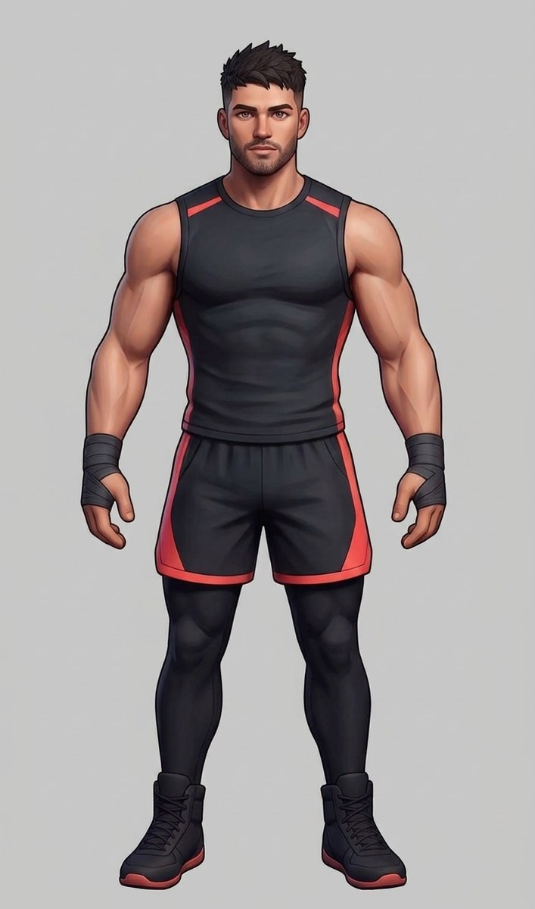
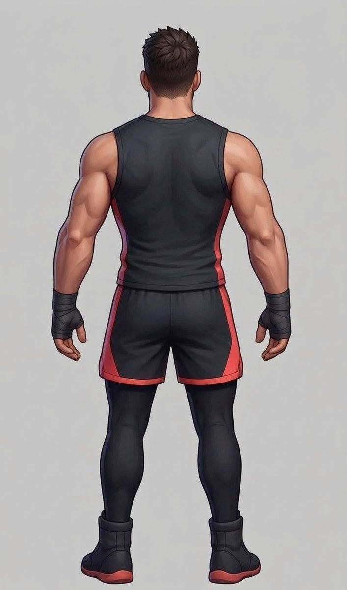
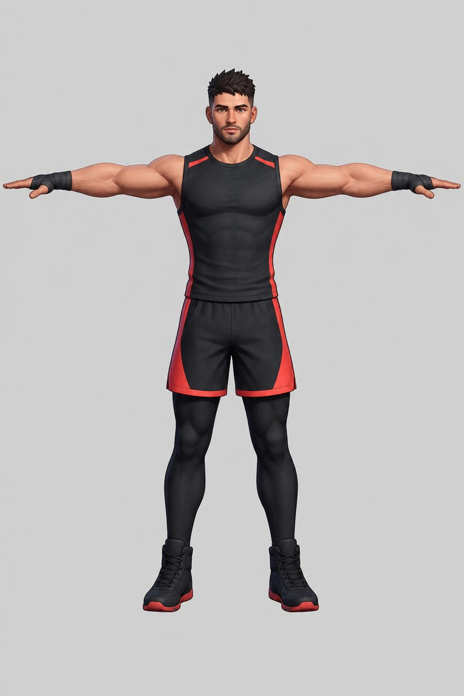
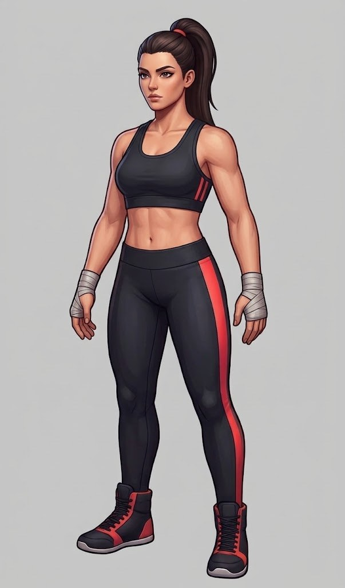

# Exercise animations

**English** · [Italiano](README.it.md)

Every exercise in the app can show a short looping animation: in the exercise
details and during the guided workout. We are starting **from scratch**: for now
every exercise shows two photos. **You can help without writing any code.**

The list of exercises, with the ones already done and the ones with a start image
ready: [EXERCISES.md](EXERCISES.md). Start from *Priority 1*: they are the ones
almost every plan uses.

## How it works

1. **We provide the start image**: the avatar already in the starting position of
   the exercise, in [`start/`](start/). You only animate it.
2. **You turn it into a short 2D video** with an image-to-video tool.
3. We check it and add it to the app.

**Never create or edit images of the avatars yourself**, not even small fixes:
generated images always come out a little different (face, outfit, proportions)
and the catalog would stop looking like one set. If the exercise you want has no
start image yet, ask for it in the issue and we will add it.

## The two avatars

For reference only, so you know how they must look in every frame:

| Male: front | Male: side | Male: back | Male: T-pose | Female: front |
|---|---|---|---|---|
|  |  |  |  |  |

Outfit: black sleeveless top (sports bra for the female avatar) with red side
panels, black leggings with red stripes (black shorts on top for the male), black
wrist wraps, black shoes with red details. Semi-realistic 3D cartoon style.

## Rules for every animation

| | |
|---|---|
| **Start** | the start image from [`start/`](start/), unchanged: same character, outfit, background, framing and view |
| **Final file** | animated WebP, **640 × 320 px** (2:1), about **15 fps**, **2–3 seconds**, infinite loop, no audio, **max 300 KB** |
| **What you send** | the WebP, or an MP4 video: we can convert it |
| **Nothing new** | no text, logo, watermark, gym, other people or objects that are not in the start image |
| **Camera** | fixed: no zoom, no pan, no cuts. The whole body and the equipment always inside the frame |
| **Movement** | **one full repetition**, slow and controlled, with correct technique. It ends exactly in the starting position, so the loop is seamless |
| **Character** | must stay identical to the start image in every frame: if the face, hair or outfit change, try again |

For the correct technique, follow the exercise instructions in
[`assets/esercizi.json`](../../assets/esercizi.json) (field `istruzioni_en`), the
same ones the app shows.

## How to make it

### 1. Animation (an image-to-video tool, e.g. Dreamina, Kling, Runway, Veo)

Give it the start image. If the tool lets you choose a **first and last frame**,
use the same image for both: the loop will be seamless. Prompts work best in
English:

```text
The character performs one slow, controlled repetition of <EXERCISE NAME>:
<the movement in one or two lines>. Correct technique, realistic body mechanics.
The character, outfit and background stay exactly as in the image.
The camera is completely still: no zoom, no pan, no cuts. The movement ends
exactly in the starting position, so the video loops seamlessly. No text.
```

Generate a few versions and keep the one with the best technique: hands, feet and
joints must not bend in strange ways.

### 2. Conversion to WebP (optional)

If you have [ffmpeg](https://ffmpeg.org/), cut the best repetition (`-ss` is where
it starts, `-t` how long it lasts) and convert:

```sh
ffmpeg -ss 0.5 -t 2.0 -i video.mp4 -an \
  -vf "fps=15,scale=640:320:force_original_aspect_ratio=increase,crop=640:320" \
  -c:v libwebp -quality 75 -compression_level 6 -loop 0 exercise_id.webp
```

If the file is over 300 KB, lower `-quality` (e.g. 60) or shorten `-t`. If you
don't have ffmpeg, just send the MP4.

## License and rights (important)

- Animations are published under **[CC0 1.0](https://creativecommons.org/publicdomain/zero/1.0/)**
  (public domain, like the exercise photos), so anyone can reuse them. The
  avatars and the start images are CC0 too.
- Use only the project start images. Never use clips, frames or characters taken
  from other apps, websites, videos or games, and never real people.
- Check that the terms of your video tool let you publish the result in an
  open-source project (some free plans don't, or add a watermark), and **say
  which tool and which plan you used** (free or paid). If you are not sure, ask
  in the issue before sending: we would rather wait than publish something we may
  not use.
- **Send the terms too**: the link to the tool's terms of service and, if they are
  separate, to the plan page, plus a screenshot or PDF of the part about who owns
  the results and whether you can publish or use them commercially, and the date
  you made the animation (terms change over time). We read them before accepting
  the animation; if they don't allow it, we can't publish it, even if it's
  beautiful.

## How to send it

1. Choose an exercise in [EXERCISES.md](EXERCISES.md) with the start image ready,
   and check the open issues, so two people don't make the same exercise.
2. Open an issue with the **Exercise animation** template, saying which exercise
   you are working on (or asking for its start image).
3. When it's ready, drag the WebP or MP4 into the issue (max 10 MB), together with
   the terms of the tool you used.
4. We check the animation and the terms, then add it to the app.

Comfortable with Git? Open a pull request against `staging` instead:

- add the file to `assets/exercises/animated/`, named after the exercise ID in
  lowercase (`Bodyweight_Walking_Lunge` → `bodyweight_walking_lunge.webp`);
- add a line to `animazioniEsercizi` in `lib/animazioni_esercizi.dart`;
- run `python tool/elenco_animazioni.py` to update [EXERCISES.md](EXERCISES.md).

Thank you! 💪
