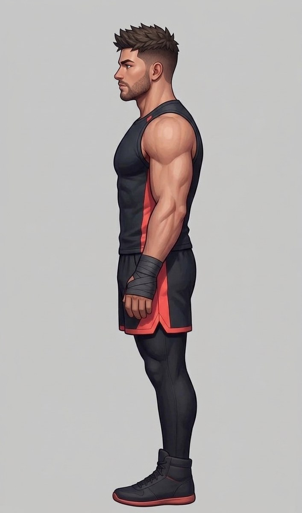

# Exercise animations

**English** · [Italiano](README.it.md)

Every exercise in the app can show a short looping animation: in the exercise
details and during the guided workout. We are starting **from scratch**: for now
every exercise shows two photos. **You can help without writing any code.**

The list of exercises, with the ones already done: [EXERCISES.md](EXERCISES.md).
Start from *Priority 1*: they are the ones almost every plan uses.

## The style in one line

Same character, same light grey background, fixed camera, one slow repetition
that loops without a jump. The first accepted animations will become the
examples for the next ones.

## The two avatars

Use one of these two characters, **exactly as they are** (face, hair, body,
outfit). One animation = one character. Pick the one you prefer.

| Male: front | Male: 3/4 | Male: side | Male: back | Male: T-pose | Female: front |
|---|---|---|---|---|---|
|  |  |  |  |  |  |

Outfit: black sleeveless top (sports bra for the female avatar) with red side
panels, black leggings with red stripes (black shorts on top for the male), black
wrist wraps, black shoes with red details.

**Style**: a hand-drawn digital illustration, like the avatars: clean dark
outlines, soft shading, smooth colours. **Not** a photo and **not** a realistic
3D render: all the animations must look like the same drawing.

The avatar images are provided only by the project: use them as the reference for
your animation, but don't publish new versions or other views of the avatars.

## Rules for every animation

| | |
|---|---|
| **Final file** | animated WebP, **640 × 320 px** (2:1), **15–24 fps** (more is smoother: 24 if the size allows), **2–3 seconds**, infinite loop, no audio, **max 300 KB** (**400 KB** for exercises with equipment or machines, which have more detail) |
| **What you send** | the WebP, or an MP4 video: we can convert it |
| **Style** | drawn like the avatars (dark outlines, soft shading) **from the first to the last frame**. Video tools often drift towards a realistic 3D look halfway through the movement: if it happens, throw the video away and try again |
| **Background** | plain light grey (about `#D9D9DB`), a slightly lighter floor, soft studio light |
| **Nothing else** | no text, logo, watermark, gym or other people. Equipment only if the exercise needs it, in matte black or dark grey |
| **Camera** | fixed: no zoom, no pan, no cuts. **Three-quarter view** (body turned about 45°, like the "Male: 3/4" avatar) for most exercises: it shows depth and the side of the movement at once. **Side** or **front view** only when the movement is unclear from three-quarters (e.g. front view for jumping jacks and lateral raises, side view for some floor exercises) |
| **Framing** | the whole body and the equipment always inside the frame, with a little margin; feet near the bottom |
| **Movement** | **one full repetition**, slow and controlled, with correct technique. It ends exactly in the starting position, so the loop is seamless |
| **One side** (↔ in [EXERCISES.md](EXERCISES.md)) | the **right side** only (the side that works or stretches): the app mirrors the animation for the left. The character never switches sides in the video. Details and ready prompts (in Italian) in [LATI.md](LATI.md) |
| **Character** | identical to the avatar images in every frame (face, hair, body, outfit). We compare them before accepting: if something changed, try again |

For the correct technique, follow the exercise instructions in
[`assets/esercizi.json`](../../assets/esercizi.json) (field `istruzioni_en`), the
same ones the app shows.

## How to make it

Every animation is a **2D video made from the avatar images**: first a still image
of the avatar in the starting position of the exercise, then an image-to-video
tool that animates it. The avatars were made this way, so the style stays the
same. No 3D models are needed. Any image or video tool is fine, as long as its
terms let you publish the result (see [License and rights](#license-and-rights-important)).

Why the extra image? An image-to-video tool uses the picture you give it as the
**first frame**: starting from the standing avatar, the video would show the
character getting into position, and the loop would not close. Some video tools
can instead take the avatar as a **character reference** and generate the exercise
directly: that's fine too, as long as the character stays identical and the
result follows the rules.

### 1. Starting image (e.g. Nano Banana / Gemini)

Upload the avatar images (three-quarter, front and side) and ask for the starting
position. If the exercise starts standing, the three-quarter avatar can already be
the starting image: widen it to 16:9 with the same background and go to step 2.
Prompts work best in English:

```text
Use the attached character exactly as he is: same face, hair, body and outfit
(black sleeveless top with red side panels, black shorts over black leggings with
red stripes, black wrist wraps, black shoes with red details), same drawing style:
hand-drawn digital illustration with clean dark outlines and soft cel shading,
not photorealistic, not a 3D render.
Show him in the starting position of: <EXERCISE NAME> (<one line from the
instructions>), seen in the same three-quarter view as the attached image
<or: from the side / from the front>.
Full body visible with some margin, plain light grey background (#D9D9DB) with a
slightly lighter floor, soft studio light. No text, no logo, no other objects
<except: EQUIPMENT in matte black>. Wide 2:1 image.
```

For the female avatar, replace "he" and the outfit with "she" and "black sports
bra with red details, black leggings with red stripes, ...".

### 2. Animation (an image-to-video tool, e.g. Dreamina, Kling, Runway, Veo)

Give it the starting image. If the tool lets you choose a **first and last frame**,
use the same image for both: the loop will be seamless.

```text
The character performs one slow, controlled repetition of <EXERCISE NAME>:
<the movement in one or two lines>. Correct technique, anatomically correct movement.
The character, outfit and background stay exactly as in the image. Keep exactly
the same hand-drawn illustration style (clean dark outlines, soft cel shading) in
every frame: the character must never turn photorealistic or 3D-rendered.
The camera is completely still: no zoom, no pan, no cuts. The movement ends exactly in the starting position, so the video
loops seamlessly. No text.
```

Generate a few versions and keep the one with the best technique: hands, feet and
joints must not bend in strange ways.

### 3. Conversion to WebP (optional)

If you have [ffmpeg](https://ffmpeg.org/), cut the best repetition (`-ss` is where
it starts, `-t` how long it lasts) and convert:

```sh
ffmpeg -ss 0.5 -t 2.0 -i video.mp4 -an \
  -vf "fps=24,scale=640:320:force_original_aspect_ratio=increase,crop=640:320" \
  -c:v libwebp -quality 75 -compression_level 6 -loop 0 exercise_id.webp
```

If the file is over the limit, lower `-quality` (e.g. 60), use `fps=20` or `fps=15`, or shorten `-t`. If you
don't have ffmpeg, just send the MP4.

## License and rights (important)

- Animations are published under **[CC0 1.0](https://creativecommons.org/publicdomain/zero/1.0/)**
  (public domain, like the exercise photos), so anyone can reuse them. The two
  avatars are CC0 too.
- Send only things **you made**. Never use clips, frames or characters taken from
  other apps, websites, videos or games, and never real people.
- If you use an AI tool, check that its terms let you publish the result in an
  open-source project (some free plans don't, or add a watermark), and **say which
  tools and which plan you used** (free or paid). If you are not sure, ask in the
  issue before sending: we would rather wait than publish something we may not use.
- **Send the terms too**, for every tool you used (the image one and the video
  one): the link to its terms of service and, if they are separate, to the plan
  page, plus a screenshot or PDF of the part about who owns the results and
  whether you can publish or use them commercially, and the date you made the
  animation (terms change over time). We read them before accepting the
  animation; if they don't allow it, we can't publish it, even if it's beautiful.
- If the animation is made with AI, **send the original video too**, exactly as the
  tool produced it, without converting it: it often carries credentials saying
  "AI-generated", and some terms forbid removing them. We keep it in
  [`originali/`](originali/) and record tools, date and terms in
  [FONTI.md](FONTI.md), where the animation is marked as AI-made.

## How to send it

1. Check [EXERCISES.md](EXERCISES.md) and the open issues, so two people don't make
   the same exercise.
2. Open an issue with the **Exercise animation** template, saying which exercise
   you are working on.
3. When it's ready, drag the WebP or MP4 into the issue (max 10 MB), together with
   the terms of the tools you used.
4. We check the animation and the terms, then add it to the app.

Comfortable with Git? Open a pull request against `staging` instead:

- add the file to `assets/exercises/animated/`, named after the exercise ID in
  lowercase (`Bodyweight_Walking_Lunge` → `bodyweight_walking_lunge.webp`);
- add a line to `animazioniEsercizi` in `lib/animazioni_esercizi.dart`;
- run `python tool/elenco_animazioni.py` to update [EXERCISES.md](EXERCISES.md).

Thank you! 💪
